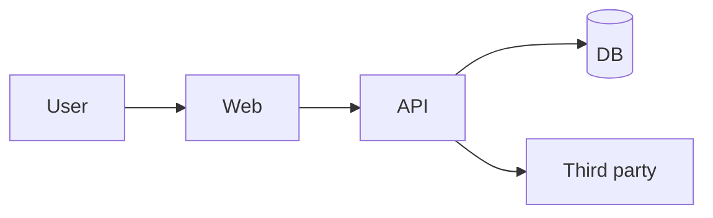

# Architecture keeper

Goal: `docs/03-SYSTEM/SYSTEM-ARCHITECTURE.md` is the single technical reference. It must match the code, not the pitch.

## 1. Inspect before writing

Read or list:

- the folder tree (skip `node_modules`, `.git`, build output)
- package manifests and lockfiles
- routes, pages, screens, server actions, API handlers
- database schema, migrations, ORM models
- auth configuration and middleware
- `.env.example`
- deployment config (`vercel.json`, `Dockerfile`, `docker-compose.yml`, `fly.toml`, `render.yaml`, etc.)
- background jobs, cron, queues
- storage and upload code
- notification code
- logging / error tracking setup
- the README, if any

Use `grep` / `glob` rather than guessing. If the project is large, start from entry points (`main`, `app`, `server`, `src/index`) and follow the imports.

## 2. Update section by section

| Section | What to update |
|---|---|
| 1. Product in one page | only if the product changed |
| 2. Current state snapshot | URLs, hosting, stack, database, auth, storage, jobs, analytics, last verified |
| 3. Context diagram | external actors and systems |
| 4. Container diagram | web, API, worker, database, storage, cache |
| 5. Component map | one row per meaningful module, with path and key files |
| 6. Critical flows | top 3–5 flows, sequence diagram + failure points |
| 7. Data model summary | link to `DATA-MODEL.md` |
| 8. API / server surface | routes, auth, validation, error format |
| 9. Auth and permissions | login, session, roles, enforcement point |
| 10. Integrations | link to `INTEGRATIONS.md` |
| 11. Background jobs | schedule, purpose, failure behaviour |
| 12. File storage | location, access, limits, retention |
| 13. Notifications | channels, providers, templates, failure |
| 14. Environments and deployment | local, staging, prod, deploy, rollback, migrations, backups |
| 15. Security and privacy | sensitive data, access, consent, retention, gaps |
| 16. Performance and reliability | expected load, bottlenecks, timeouts, offline |
| 17. Observability | logs, metrics, errors, alerts |
| 18. Technical debt | hard-coded values, duplicates, fake data, missing tests |
| 19. Intended vs current | the honest gap table |
| 20. Decisions | link to `DECISIONS.md` |
| 21. Open questions | anything you could not verify |
| 22. Change log | what changed in the architecture and why |

## 3. Diagrams

- Use Mermaid. Keep them small enough to read.
- Show the actors, the systems, and the direction of data.
- Mark third-party services clearly.
- Do not draw a component that does not exist.
- If a flow is unclear, draw the happy path and list the unknowns below it.

## 4. Current vs intended vs gap

This is the most important part. Keep three separate ideas:

- **Current:** verified in the code or the running system.
- **Intended:** what the owner wants, from the PRD.
- **Gap:** what is missing between them.

Never describe an intended component as if it exists. If the demo shows a fake payment, say so in `CURRENT-STATE.md`.

## 5. Cross-update

If the architecture changed, also update:

- `docs/03-SYSTEM/DATA-MODEL.md` for entities and fields
- `docs/03-SYSTEM/INTEGRATIONS.md` for services and env vars
- `docs/02-PRODUCT/PRD.md` for non-functional requirements
- `docs/04-DELIVERY/DECISIONS.md` for the why
- `docs/04-DELIVERY/CURRENT-STATE.md` for real vs mocked
- `docs/04-DELIVERY/OPEN-QUESTIONS.md` for anything unverified

## Rules

- Do not document what you did not inspect.
- Do not write secret values. Names and locations only.
- Do not copy a vendor's architecture diagram. Describe what this app actually does.
- Do not hide technical debt. The next team needs the truth.
- If the code is too messy to map, say so and map the entry points first.
- Update the "Last verified" field every time.
