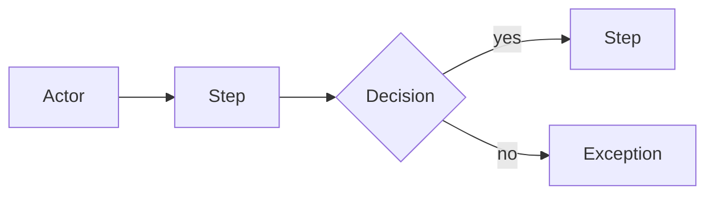

# Deep dive

Goal: turn a vague process into rules, examples, exceptions and history that a professional team can build from.

Pick **one topic**: a workflow, department, role, data set, integration, money path, or recurring decision.

For domain-specific workflows, use `docs/01-BUSINESS/DOMAIN-CHECKLIST.md` as a prompt sheet. It is a list of questions, not a list of facts. Ask only the items that apply.

## 1. Set the scope

Say:

> "Let's dig into **[topic]**. I will ask a few questions at a time. Stop me if I go too deep or if a question does not make sense."

Ask the owner to describe it in one sentence first. Write it down.

## 2. The depth ladder

Work through these levels. Ask 1–3 questions per message.

### Level 1 — The surface

- What is it?
- Who does it?
- When does it happen?
- What is the output?

### Level 2 — The real steps

- Walk me through last Tuesday, step by step.
- What happens right before step one?
- Who hands what to whom?
- Where does it wait? Where does it get lost?
- What system or sheet is open at each step?

### Level 3 — The rules

- What must always be true?
- What is never allowed?
- Who approves an exception?
- What is checked before the next step can start?
- What is the same every time, and what changes?

### Level 4 — The exceptions

- What goes wrong most often?
- What happens when the person is on leave, offline, or on the phone?
- What if the data is missing, wrong, or duplicated?
- What is the once-a-month exception?
- What happens on the busiest day?
- What happens when someone makes a mistake? Can it be undone?

### Level 5 — The why

- Why is it done this way?
- Is that a rule, a habit, or a workaround?
- What did you try before? Why did it fail?
- Who disagrees with this approach?
- What would make you change it?
- What does "good" look like, in a specific example?

### Level 6 — The cost

- What does a mistake cost — money, time, customer trust, legal risk?
- What is the cost of doing it slowly?
- What happens if it is skipped entirely?
- Who notices first when it goes wrong?

## 3. Draw it

Add a Mermaid flow diagram to `docs/02-PRODUCT/WORKFLOWS.md`. Show actors, decisions and exceptions, not just the happy path.

## 4. Write the topic

Add a `## Topic: [name]` section to `docs/01-BUSINESS/DEEP-CONTEXT.md` with:

- **What we heard** — the owner's exact words
- **What it means** — your plain-language interpretation
- **How it works today** — numbered steps
- **Rules and exceptions** — table
- **Real examples** — a specific day, person, amount, outcome
- **Why this way** — history and ideology
- **What happens when it goes wrong** — failure table
- **Volume, timing and pressure**
- **Contradictions and changes over time**
- **Open questions**

Also update:

- `docs/02-PRODUCT/WORKFLOWS.md` — the workflow entry
- `docs/02-PRODUCT/PRD.md` — any new requirement or acceptance criterion
- `docs/04-DELIVERY/DECISIONS.md` — any rule that was chosen
- `docs/04-DELIVERY/OPEN-QUESTIONS.md` — anything unresolved

## 5. Read it back

End with:

> "Here is what I now believe: **[3–5 bullets]**. What is wrong or missing?"

Record the corrections. Do not defend your interpretation.

## Rules

- One topic. Do not drift into other workflows.
- Ask for examples, not opinions.
- When the owner contradicts an earlier answer, record both with dates and ask which is current.
- When the owner says "it depends", ask "depends on what?" and list the conditions.
- When the owner cannot answer, write `[UNKNOWN]` and move on. Do not fill the gap with a guess.
- Stop when the answer stops changing. Deep enough is when a new employee could follow it without asking.
