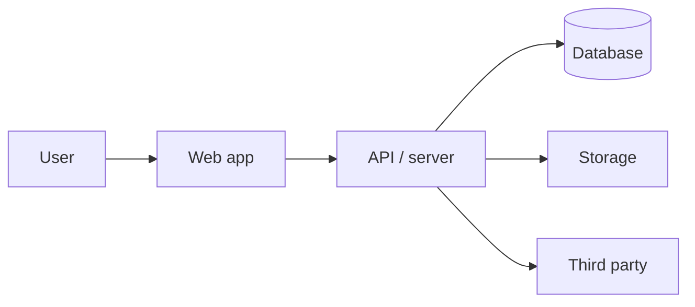

# Handoff brief

> **What this is:** The one-page brief for the next person. It answers: what did the owner want, what exists, what is real, what is fake, what is broken, how do you run it, and what should happen first.
> **How to fill:** The `handoff` skill fills this at the end. Audit the code and the notebook first. Do not copy claims from the demo. Mark unknown honestly.
> **Truth labels:** `[CONFIRMED]` · `[OBSERVED]` · `[ASSUMED]` · `[UNKNOWN]` · `[DECISION]`

## 1. Executive summary

- **Project:** [UNKNOWN]
- **Owner / company:** [UNKNOWN]
- **One-line idea:** [UNKNOWN]
- **What was built:** [UNKNOWN]
- **What it is good for today:** [UNKNOWN]
- **What it is not ready for:** [UNKNOWN]
- **Recommended first move for the next person:** [UNKNOWN]

## 2. What the owner wanted

### The business problem

[UNKNOWN]

### The users

[UNKNOWN]

### The first workflow they wanted

[UNKNOWN]

### What success means to them

[UNKNOWN]

### What they explicitly did not want

[UNKNOWN]

## 3. What was built

| Area | What exists | Status | Evidence |
|---|---|---|---|
| [UNKNOWN] | | ✅ / 🟡 / 🧪 / ❌ / ⬜ | |

### Screens / routes

| Route / screen | Purpose | Who can use it | Status |
|---|---|---|---|
| [UNKNOWN] | | | |

### Workflows

| Workflow | Complete? | Notes |
|---|---|---|
| WF-___ | | |

## 4. What is real, what is fake, what is broken

### Real and verified

- [UNKNOWN]

### Mocked, fake or hard-coded

- [UNKNOWN]

### Broken or fragile

- [UNKNOWN]

### Untested

- [UNKNOWN]

Full detail: `docs/04-DELIVERY/CURRENT-STATE.md`.

## 5. How to run it

### Requirements

- Runtime / version: [UNKNOWN]
- Package manager: [UNKNOWN]
- Database: [UNKNOWN]
- Other services: [UNKNOWN]

### Local setup

```bash
# [UNKNOWN]
```

### Environment variables

Names only. Values are in the owner's hosting dashboard, not in this package.

| Variable | Purpose | Where the value lives |
|---|---|---|
| [UNKNOWN] | | |

### Run

```bash
# [UNKNOWN]
```

### Test

```bash
# [UNKNOWN]
```

### Deploy

- **Hosting:** [UNKNOWN]
- **Deploy command / trigger:** [UNKNOWN]
- **Rollback:** [UNKNOWN]

## 6. Architecture in one page



- **Frontend:** [UNKNOWN]
- **Backend:** [UNKNOWN]
- **Database:** [UNKNOWN]
- **Auth:** [UNKNOWN]
- **Storage:** [UNKNOWN]
- **Jobs:** [UNKNOWN]
- **Integrations:** [UNKNOWN]

Full detail: `docs/03-SYSTEM/SYSTEM-ARCHITECTURE.md`.

## 7. Data and accounts

### Data

- **Real data present:** [UNKNOWN]
- **Fake / seed data present:** [UNKNOWN]
- **Sensitive data present:** [UNKNOWN]
- **Backups:** [UNKNOWN]
- **Retention / deletion:** [UNKNOWN]

### Accounts and ownership

| Service | Purpose | Account owner | Company-owned? | Access notes |
|---|---|---|---|---|
| [UNKNOWN] | | | | |

Do not include passwords or secret values in this document.

## 8. Known bugs and risks

| Issue | Impact | Severity | Suggested action |
|---|---|---|---|
| [UNKNOWN] | | | |

Full risk list: `docs/04-DELIVERY/CURRENT-STATE.md` and `docs/03-SYSTEM/SYSTEM-ARCHITECTURE.md` §18. Scenario coverage: `docs/04-DELIVERY/SCENARIOS.md`.

## 9. Open questions and assumptions

### Questions only the owner can answer

| ID | Question | Why it matters |
|---|---|---|
| Q-___ | [UNKNOWN] | |

### Assumptions the build currently relies on

| ID | Assumption | Risk if wrong |
|---|---|---|
| A-___ | [UNKNOWN] | |

Full list: `docs/04-DELIVERY/OPEN-QUESTIONS.md`.

## 10. What the owner wants next

| Priority | Request | Why | Status |
|---|---|---|---|
| 1 | [UNKNOWN] | | |

## 11. How the owner works

- **Prompting style:** [UNKNOWN]
- **What they care about most:** [UNKNOWN]
- **What they tend to ignore:** [UNKNOWN]
- **How they decide:** [UNKNOWN]
- **Words they use:** [UNKNOWN]
- **Advice for the next person:** [UNKNOWN]

Full detail: `docs/05-SESSIONS/PROMPTING-PATTERNS.md`.

## 12. Package contents

| Item | What it is |
|---|---|
| `docs/` | the full notebook |
| `code/` | code snapshot, without `node_modules`, `.git`, `.env` or build output |
| `kit/` | the skills, hooks and tools that maintained the notebook |
| `meta/git-info.txt` | remote, branch, HEAD, recent commits, working tree status |
| `meta/git-history.bundle` | full git history |
| `meta/changes.patch` | uncommitted diff at handoff |
| `meta/env-vars.txt` | environment variable names only |
| `meta/file-tree.txt` | snapshot file tree |
| `meta/secret-scan.txt` | possible secret locations, values not shown |
| `manifest.json` | machine-readable package index |

## 13. Recommended first two weeks for the next person

1. **Day 1–2: reproduce.** Run from a clean machine. Confirm setup, env vars, database and deploy.
2. **Day 2–3: verify the critical workflow.** Run it end to end. Compare to `WORKFLOWS.md`.
3. **Day 3–4: security and access review.** Auth, roles, secrets, public buckets, customer data.
4. **Day 4–5: replace fake data and hard-coded values.** Decide what to keep, refactor or rebuild.
5. **Week 2: harden the money path.** Add tests, error handling, backups and monitoring.
6. **Week 2: agree the production plan with the owner.** Scope, milestones, acceptance.

## 14. Handoff checklist

- [ ] `docs/04-DELIVERY/CURRENT-STATE.md` is honest and current.
- [ ] Every P0 requirement maps to a workflow, screen and test.
- [ ] `SYSTEM-ARCHITECTURE.md` matches the code.
- [ ] `.env.example` lists every required variable.
- [ ] No real secret is in the package.
- [ ] The app runs from a clean machine.
- [ ] The git bundle and uncommitted diff are included.
- [ ] The owner has confirmed the open questions that block the next build.
- [ ] The owner knows what happens next.

## 15. Sign-off

- **Prepared by:** [UNKNOWN]
- **Date:** —
- **Owner confirmed the brief:** [UNKNOWN]
- **Open items carried past handoff:** [UNKNOWN]
